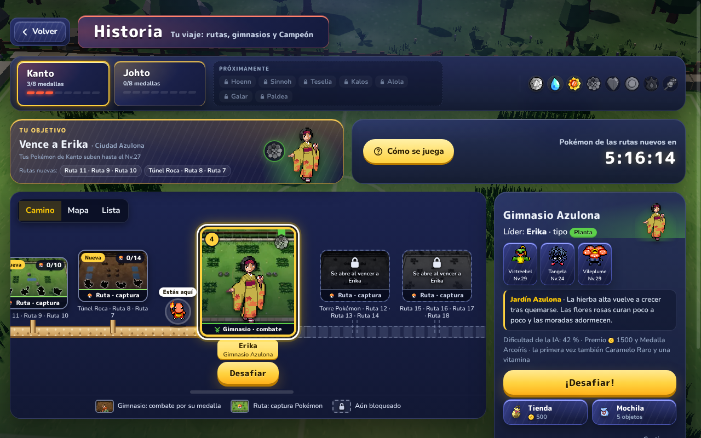
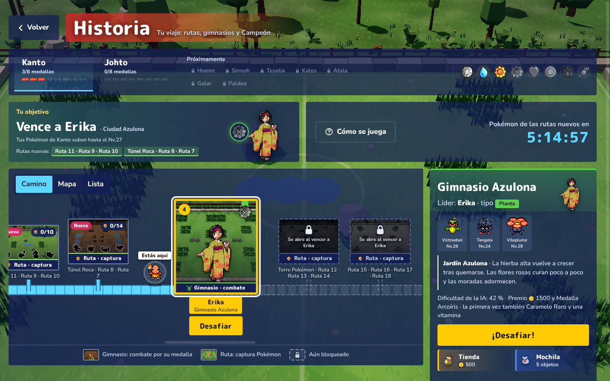
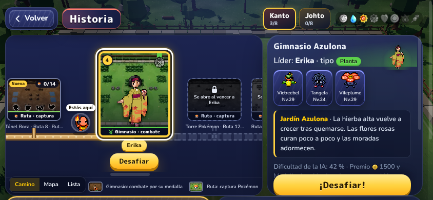
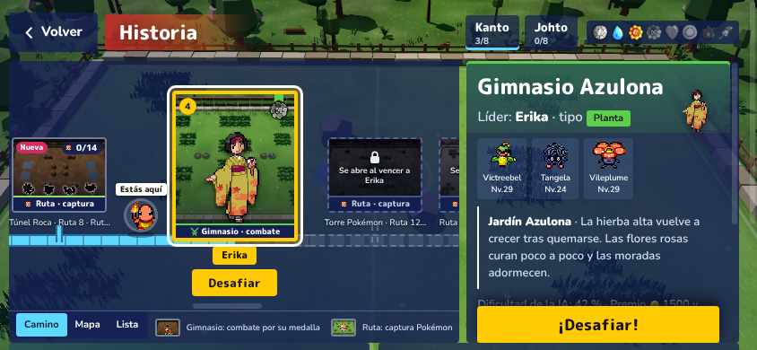

# Camino de Historia más visual

La vista «Camino» de Historia (`public/js/storypath.js`) ya enseñaba el orden del viaje, pero todo eran círculos
parecidos: quien no ha jugado nunca a Pokémon no sabía qué era un gimnasio ni qué era una ruta. Ahora cada sitio es
una **tarjeta-lugar con la foto de su arena**, que dice con una etiqueta qué se hace allí, y el camino parece un
camino.

- Rama: `camino-visual` (desde `ui-propuestas`). Es la vista por defecto y vale para todos los temas.
- Código: `public/js/storypath.js`; estilos en `public/cards.css` (bloque «Historia: el camino») y en
  `public/mobile.css` (móvil en horizontal); los temas A, B y C, en `public/themes/`.
- Test: `tests/e2e/camino.e2e.js` (en 1280×800, 844×390 y 667×375).

## Capturas

Perfil de prueba: Charmander nivel 20 y 3 medallas de Kanto (como `tests/e2e/temas.e2e.js`).

| | Sin tema | Tema C (`?tema=c`) |
|---|---|---|
| Escritorio 1280×800 |  |  |
| Móvil 844×390 |  |  |

Antes: [escritorio](camino-visual/antes/escritorio-sin-tema.png), [escritorio con tema C](camino-visual/antes/escritorio-tema-c.png)
y [móvil](camino-visual/antes/movil-sin-tema.png).

## El diseño

**Gimnasio = tarjeta-lugar.** La foto de su arena de fondo (`img/arenas/<n.map>.webp`, la misma clave de arena que
usa el combate: `g-roca`, `g-agua`…), el líder de pie delante (`trainerImg`), el marco del color de su tipo, el
número de orden arriba a la izquierda y la medalla colgando de una cinta del color del tipo (en gris si aún no es
tuya). Abajo, una franja con dos espadas: **«Gimnasio · combate»**.

**Ruta = tarjeta-lugar más pequeña.** La foto de su terreno (`pradera`, `bosque`, `cueva` o `lago`), 4 de sus
Pokémon (primero los que tienes, en color; el resto como **silueta oscura** con un borde claro, tipo «¿quién es ese
Pokémon?»), la Poké Ball con «2/7» arriba a la derecha (verde y con ✓ si están todos), «Nueva» arriba a la izquierda
si se acaba de abrir y la franja **«Ruta · captura»** con una Poké Ball.

**El camino.** Una franja de tierra con piedrecitas por la que se ha andado (de la salida, con el cartel del pueblo,
hasta el siguiente reto) y, desde ahí, baldosas apagadas con el borde discontinuo. Las rutas no cuelgan encima del
gimnasio: salen del tramo de antes de cada gimnasio por un caminito propio (de tierra si están abiertas). Así todo
está a la misma altura y en el móvil cabe entero de alto. Con el tema C, lo recorrido son baldosas celestes que se
dibujan al entrar (como el eje de antes).

**«Estás aquí».** El avatar del jugador (el de la cabecera del menú, `this.avatar`) de pie en el camino, justo a la
izquierda del siguiente reto. El siguiente reto sigue siendo lo único grande, dorado y que late, y tiene el único
botón «Desafiar» del camino, debajo de su nombre; ahora también en el móvil (antes se escondía allí).

**Bloqueado.** La foto en gris y apagada, el marco discontinuo, un candado y «Se abre al vencer a {who}» dentro de
cada tarjeta (antes era un texto suelto encima del tramo). Las rutas bloqueadas no enseñan sus Pokémon.

**La Liga.** Un lugar grande al final: el edificio de la Liga (`tiles/league.png`) delante de la foto de la arena
del primer miembro del Alto Mando, «Liga · combate» y, con ella abierta, «Combate n de 5» y el «Desafiar» del
combate que toca. Al acabarla, una corona; y el jugador, al final del camino.

**La leyenda**, más corta y visual: una miniatura de gimnasio (foto y líder) = «Gimnasio: combate por su medalla»,
una de ruta (pradera y Poké Ball) = «Ruta: captura Pokémon» y el candado = «Aún bloqueado» (en el móvil, solo las
dos primeras, en la fila de las pestañas).

**Igual que antes:** tocar un sitio abre su ficha al lado; al abrir se elige y se centra lo que toca; cada sitio es
un botón con nombre (`aria-label` con el sitio, lo que se hace allí y su estado: «4. Gimnasio Azulona · Erika ·
Gimnasio · combate · Tu siguiente reto»), con foco visible (contorno amarillo en la tarjeta). Las fotos van con
`loading="lazy"` y son pequeñas (320×200, de 6 a 10 KB en WebP).

**Medidas.** Escritorio: gimnasio 140×160, siguiente reto 176×200, ruta 128×96. Móvil en horizontal: 110×136,
140×168 y 106×84, con todo entero de alto en 844×390 y 667×375 (se desplaza de lado).

**Textos nuevos** (en los 7 idiomas): «Gimnasio · combate», «Ruta · captura», «Liga · combate», «Gimnasio: combate
por su medalla» y «Ruta: captura Pokémon». Sale «Rutas: Pokémon capturados», que ya no se usa.

## Qué comprueba el test

`tests/e2e/camino.e2e.js`, como un jugador (entra con el ratón, cierra la guía con «¡A jugar!» y recorre el camino
de punta a punta), en 1280×800 y en el móvil en horizontal (844×390 y 667×375, con pantalla táctil):

- Se ven los 8 gimnasios, la Liga y las rutas; cada gimnasio dice «Gimnasio · combate» y cada ruta «Ruta · captura»,
  la etiqueta cabe y no la tapa nada; la Liga dice «Liga · combate».
- Erika (lo que toca) es la tarjeta más grande; hay un solo «Desafiar» en el camino, a la vista y sin nada encima;
  «Estás aquí» está junto a ella; Koga (bloqueado) dice «Se abre al vencer a Erika».
- En el móvil, el camino cabe entero de alto en la pantalla; la leyenda explica qué es un gimnasio y qué una ruta.
- En la Ruta 1, con un Pidgey capturado: enseña 3 o 4 Pokémon, Pidgey se pinta en color y los demás casi negros
  (se mira lo que se pinta con su filtro, no la clase) y dice «1/9». Tocarla abre su ficha y «Desafiar» empieza el
  combate contra Erika.

## Decisiones pendientes para el dueño

1. **Dónde van las rutas.** Ahora salen del tramo de antes de su gimnasio, a la misma altura (para caber en el
   móvil). Antes colgaban encima del gimnasio. Si se prefiere encima, en el móvil habría que hacer las tarjetas más
   pequeñas.
2. **¿Dos «Desafiar»?** El del camino y el «¡Desafiar!» de la ficha de al lado hacen lo mismo. En el móvil se podría
   volver a esconder el del camino (era así) o quitar el de la ficha cuando se ve el camino.
3. **Qué Pokémon enseña cada ruta.** Ahora, los 4 primeros de su lista, con los que ya tienes delante. Otra opción:
   los 4 de la tanda actual (cambian cada 6 horas), que son los que de verdad se pueden encontrar ahora.
4. **La foto de la Liga.** No hay foto propia del estadio: va la de la arena del primer miembro del Alto Mando con el
   edificio de la Liga delante. Una foto de verdad del estadio quedaría mejor.
5. **El avatar «de pie».** Es el avatar redondo del menú (con su marco) sobre una sombra en el camino; no hay un
   sprite del jugador de cuerpo entero. Si se quiere de cuerpo entero, haría falta ese sprite.
6. **Tema D.** Está en la rama `tema-d` (no en `ui-propuestas`), así que no se ha probado aquí. Sus reglas del camino
   usan `.sp-spine` y `.sp-dot`, que ya no existen: al juntar las ramas hay que pasarlas a `.sp-card` (las tarjetas)
   y a `.sp-ch::before` (el camino), como se ha hecho con los temas A, B y C.
7. **Temas A y B.** Se han quitado sus reglas de los círculos y del eje de antes y se ven con el diseño nuevo sin
   adaptar (no se pedía); si siguen en pie, falta darles su toque.
8. Sin versión ni notas de parche (se harán al publicar): la novedad para el jugador sería «el Camino de Historia,
   con la foto de cada sitio y qué se hace en él».

## Pruebas pasadas

`npm test` en verde; `node tools/i18n-check.js --strict` en verde; e2e uno detrás de otro: `camino`, `temas`,
`rutas`, `lideres`, `liga` y los cuatro barridos `pantallas-*` (nada tapado, desbordado ni inaccesible, axe WCAG AA)
en verde. `mapa.e2e.js` falló una vez en la tanda («tapado por div.modal»: la guía de la primera vez sale a los
400 ms y el test la quita antes) y pasó las dos veces que se repitió solo; no toca nada de esta rama, pero conviene
que espere a la guía y la cierre con «¡A jugar!».
