# Propuestas de aspecto para PokéArenas

Hay tres direcciones para elegir antes de cambiar nada. Cada una es una capa opcional, que **no cambia el aspecto
de siempre**: sin tema no se carga ninguna hoja.

- Para verla: `?tema=a`, `?tema=b` o `?tema=c` en la dirección (por ejemplo `http://localhost:3000/?tema=b`). Se
  recuerda en `localStorage` (`arena.tema`) y `?tema=no` la quita.
- Cómo está hecho: `public/js/tema.js` carga `public/themes/tema-X.css` después de `mobile.css` y pone la clase
  `tema-X` en el `<body>`. Todas las reglas van bajo `body.tema-X`.
- El test e2e `tests/e2e/temas.e2e.js` comprueba lo siguiente: sin tema no se pide nada, con tema se ve y se recuerda,
  `?tema=no` lo quita y «¡Desafiar!» sigue a la vista y sin nada encima.
- Alcance: el menú principal y la pantalla de Historia (la vista «Camino» y la ficha de al lado), en escritorio
  (1280×800) y en el móvil en horizontal (844×390). El resto de pantallas sigue con el aspecto actual aunque haya un
  tema puesto.

## Qué se quiere arreglar

La revisión de diseño vio en la interfaz actual estos rasgos «de plantilla»:

1. **Todos los bloques son la misma tarjeta**: redondeada, con degradado, brillo, rayas, reflejo y sombra. Los
   modos del menú, las filas de misiones, la colección, el objetivo y la ficha son todos iguales.
2. **Etiquetas en mayúsculas sobre los bloques**: «TU OBJETIVO», «PRÓXIMAMENTE», «MISIONES DIARIAS», «AVENTURA»,
   «JUGAR ›».
3. **Datos unidos con puntos medios**: «Kanto 3/8 · Johto 0/8 · 4 Pokémon».
4. **El dorado está en todo**, así que no señala nada. Son dorados los diez «Jugar», el borde de Lucky Spin, la
   Tienda, Logros, el panel de misiones, «Cómo se juega», la pestaña de región elegida, el reloj, las marcas de
   los títulos y el siguiente reto.
5. **Brillos y animaciones en muchos sitios a la vez**: misiones, Logros, Lucky Spin, Novedades, el corazón de
   Apoyar, el Tutorial y el siguiente reto laten todos a la vez.

Las tres propuestas aplican los mismos principios:

- Partir del propio tema: la forma de las interfaces de los juegos de Pokémon.
- Gastar el atrevimiento en un solo sitio por pantalla.
- Dorado solo para «lo que toca hacer ahora». En el menú es Historia, y en Historia el siguiente reto y
  «¡Desafiar!».
- Un solo movimiento pensado por pantalla. Con `prefers-reduced-motion` no hay ninguno.
- Etiquetas en minúsculas, como frases.
- Contraste de 4,5:1 o más en el texto, foco visible y que todo quepa en 844×390.

Cada propuesta resuelve los rasgos 1, 2, 4 y 5 solo con CSS. **El 3 (los puntos medios) no se puede arreglar con
CSS**, porque es texto que monta el JS. Para el tema que se elija se propone, por ejemplo, que la tarjeta de
Historia muestre las medallas de cada región con sus pastillas (como `.rg-pips`) en vez de «Kanto 3/8 · Johto 0/8»,
y que «Ruta 11 · Ruta 9 · Ruta 10» pase a ser una lista. No está hecho.

## Capturas

Están en `docs/propuestas-ui/`, con el mismo perfil de prueba en todas (3 medallas de Kanto y 4 Pokémon). En cada
fila se compara el aspecto actual con las tres propuestas.

| | Actual | A · Caja de texto | B · Pokédex | C · Ruta |
|---|---|---|---|---|
| Menú, escritorio | 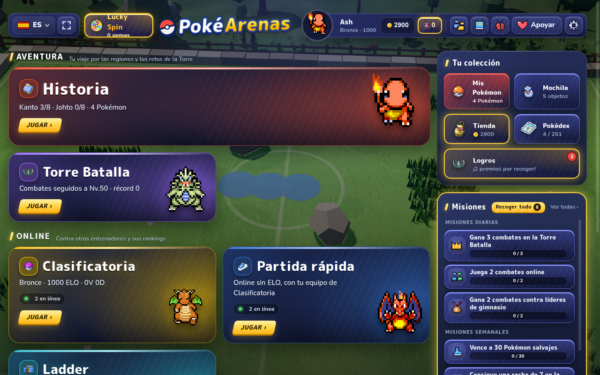 | 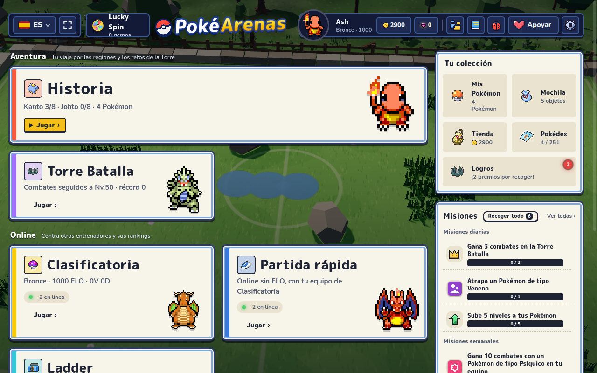 | 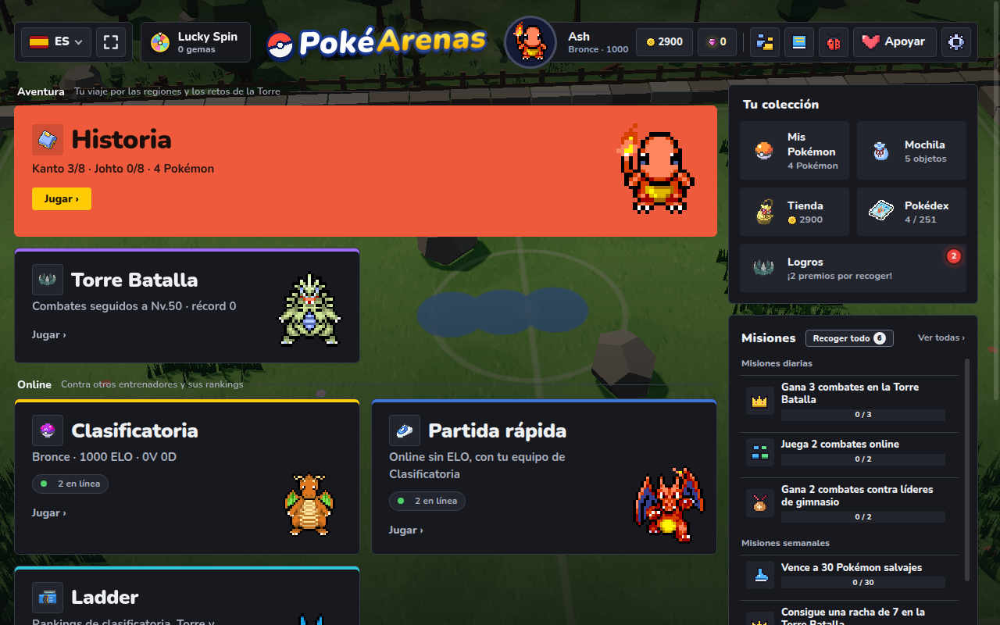 | 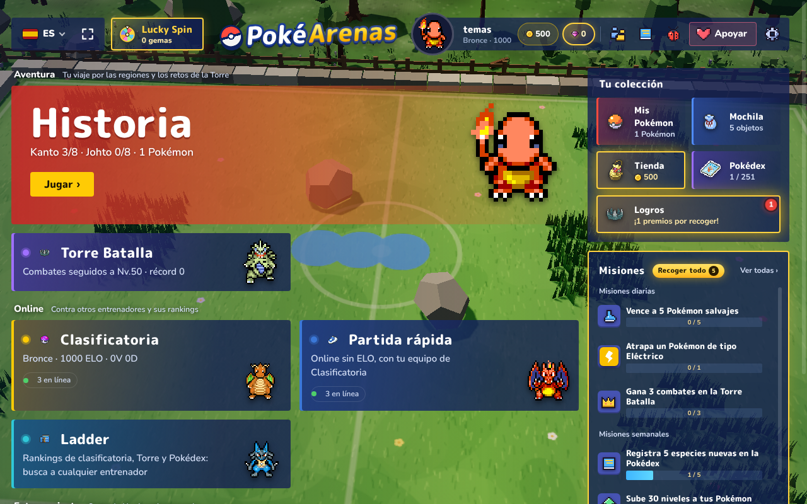 |
| Historia, escritorio | 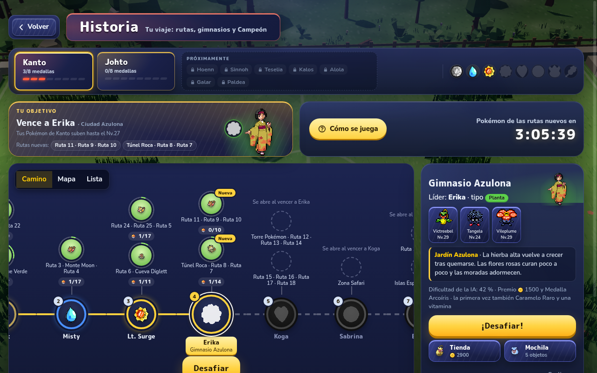 | 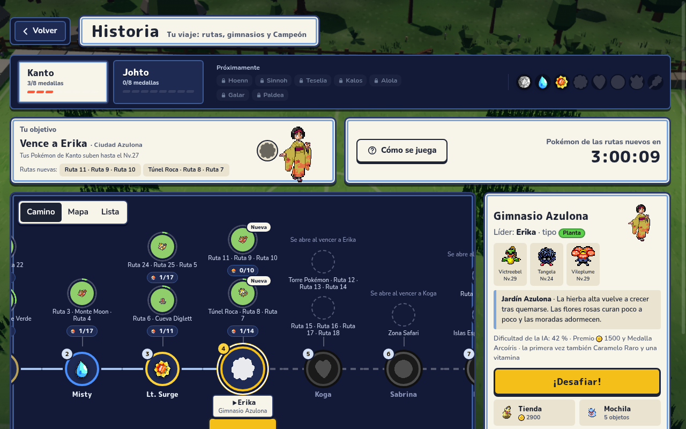 | 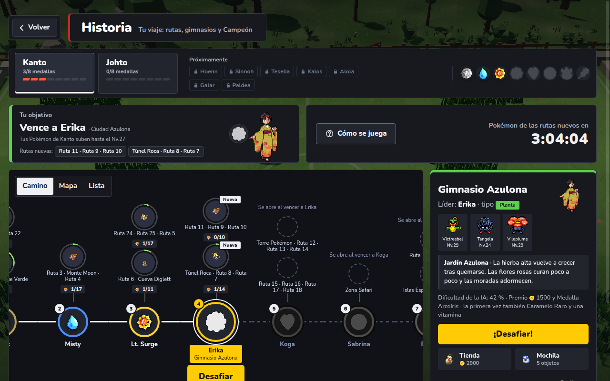 | 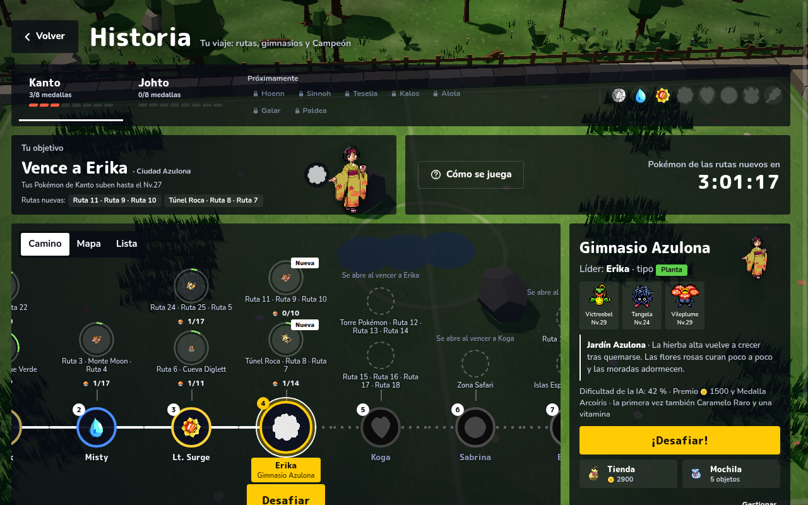 |
| Menú, móvil | 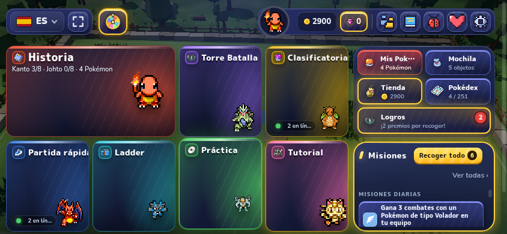 | 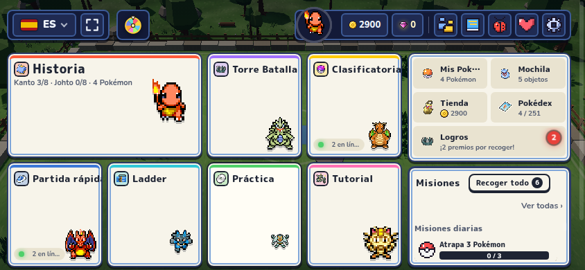 | 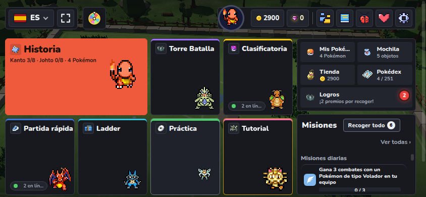 | 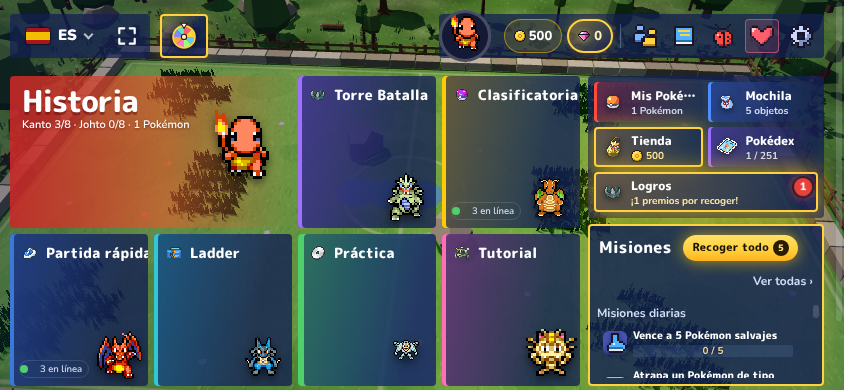 |
| Historia, móvil | 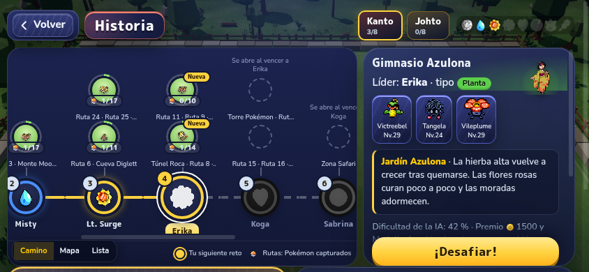 | 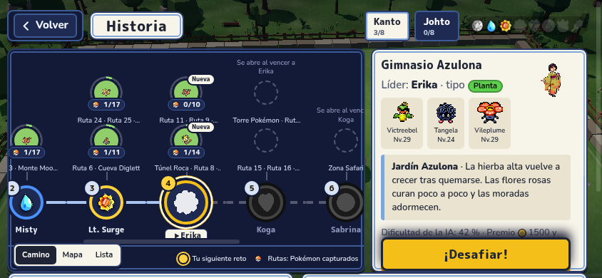 | 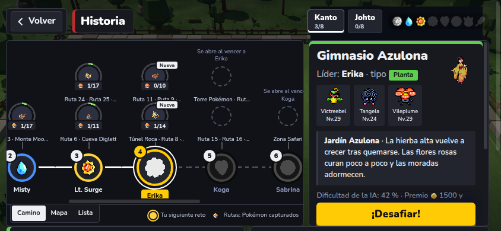 | 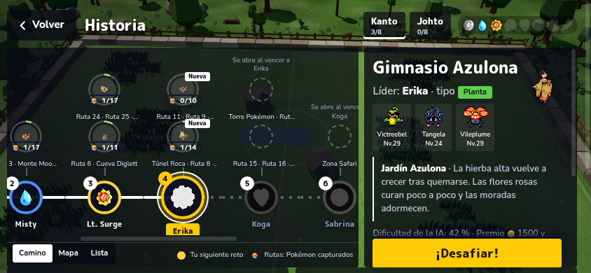 |

## A · «Caja de texto» (GBA/DS)

Toma la forma de los menús de Rojo Fuego, Esmeralda y Diamante. Lo que se lee va en cajas de papel claro con marco
doble y sombra dura. Lo de alrededor (la cabecera y el camino) es «el mundo»: oscuro y liso. El cursor ▶ de los
menús de Pokémon marca lo que eliges.

| Token | Valor | Uso |
|---|---|---|
| `--ta-paper` | `#f7f4ea` | fondo de las cajas |
| `--ta-ink` | `#1e2433` | texto sobre el papel (14,1:1) |
| `--ta-mute` | `#535c70` | texto secundario (6,1:1 sobre el papel; 5,2:1 sobre `--ta-paper-2`) |
| `--ta-frame` / `--ta-band` | `#2b3a67` / `#7fa6d9` | marco doble: borde oscuro y banda clara por dentro |
| `--ta-field` | `#131a38` | el mundo: cabecera, pestañas y el camino |
| `--ta-now` | `#f5bf1a` | solo lo que toca (tinta encima: 9,1:1) |

- **Letra**: M PLUS Rounded 1c para los títulos y Nunito para el texto. Las dos ya están en `public/vendor/fonts`.
  Para ir más lejos se podría añadir una letra de píxel libre (OFL), por ejemplo *Pixelify Sans* o
  *Press Start 2P*, alojada en `public/vendor/fonts` como las otras. Solo serviría para cifras y rótulos cortos,
  porque no tiene caracteres chinos, japoneses ni coreanos. No está incluida.
- **Paneles**: 3 px de marco y 3 px de banda, esquinas de 10 px, sombra dura de 4 px sin difuminar. Sin
  degradados, brillos ni reflejos. Dentro de las cajas no hay tarjetas, sino filas lisas (`--ta-paper-2`). Las
  barras de progreso son como la barra de PS de los combates de GBA.
- **Atrevimiento**: cada modo lleva una franja lisa de su color. Historia es el único «Jugar» con forma de botón
  dorado. La región elegida es una caja de papel, no un brillo dorado.
- **Camino**: el tramo recorrido va en el azul claro de la banda. El dorado queda solo para el siguiente reto.
- **Movimiento**: el cursor ▶ de lo que toca va y viene a saltos (`steps`), como la flecha de las cajas de texto.
  En el menú está en Historia y en el camino en el siguiente reto. Nada más se mueve.
- **Móvil**: los marcos son de 2 px y la franja del modo va arriba, porque a la izquierda no cabían los nombres.

Qué arregla: las tarjetas dejan de ser todas iguales (cajas de papel, el mundo oscuro y filas dentro), el dorado
queda en un sitio por pantalla y deja de latir todo a la vez. Es la más «Pokémon» de las tres. A cambio, es la
más llamativa: el papel claro pesa mucho sobre el 3D, y llevarla al resto de pantallas es lo que más trabajo da,
porque hay que revisar el color de texto de cada panel, que hoy da por hecho un fondo oscuro.

## B · «Pokédex» (plano, colores de tipo)

Trata la interfaz como el aparato Pokédex: superficies de carbón lisas separadas por líneas finas, esquinas
pequeñas y datos legibles. El color sale solo de los tipos y del color de cada modo, como pestaña de índice.

| Token | Valor | Uso |
|---|---|---|
| `--tb-body` | `#17191f` | superficie de los paneles |
| `--tb-row` | `#22252e` | filas, huecos y botones secundarios |
| `--tb-line` | `#363a47` | líneas de 1 px (no hay sombras) |
| `--tb-text` / `--tb-mute` | `#eef0f4` / `#a7adbb` | texto (15,4:1) y secundario (7,8:1; 6,8:1 sobre `--tb-row`) |
| `--tb-red` | `#c8272b` | el rojo de la Pokédex, solo como filo del cartel de cada pantalla |
| `--tb-now` | `#ffcb05` | solo lo que toca (tinta encima: 12:1) |

- **Letra**: Nunito en todo, también en los títulos (900, con algo menos de espacio entre letras). Las cifras van
  tabulares, para que el reloj y los contadores no bailen. Es más sobria y lee mejor los números.
- **Paneles**: fondo liso, borde de 1 px, esquinas de 4 a 6 px, sin sombra ni desenfoque. Las secciones del menú
  son un índice: el nombre y una línea hasta el borde. Las misiones y la colección son listas.
- **Atrevimiento**: Historia es un bloque liso de su color (tinta encima, 5,5:1), con el único botón dorado. En
  Historia lo atrevido es el siguiente reto, con su anillo y su nombre en dorado. El objetivo y la ficha del líder
  llevan el color del tipo del líder (Planta para Erika) como filo.
- **Movimiento**: una sola vez y sin bucles. En el menú, Historia entra primero y lo demás 0,18 s después. En el
  camino, el siguiente reto lanza dos ondas al abrir.
- **Eje del camino**: blanco lo recorrido y punteado lo que falta, así que el dorado ya no se usa para el progreso.

Qué arregla: tiene la jerarquía más clara de las tres, quita todos los efectos y deja que el color del tipo dé
la información. A cambio, es la menos «de juego»: sin el bloque de Historia y los tipos podría ser cualquier panel
de datos. Un detalle: el anillo de un gimnasio ganado de tipo Eléctrico es amarillo (es el color del tipo) y se
parece algo al dorado de «lo que toca». Se distingue por el tamaño y la etiqueta, pero habría que vigilarlo.

## C · «Ruta» (HUD ligero sobre el mundo)

El juego ya tiene un mundo 3D detrás de los menús, así que esta propuesta lo deja ser el protagonista. La interfaz
se queda en lo justo: velos oscuros sin bordes ni sombras, letra grande y casi ninguna caja dentro de otra. Recuerda
a una pantalla de título o al HUD de los juegos en 3D.

| Token | Valor | Uso |
|---|---|---|
| `--tc-veil` | `rgba(8,10,20,.8)` | velo de los paneles. Sobre un fondo blanco, el blanco da 11,2:1 y el secundario 6,8:1 |
| `--tc-row` | `rgba(255,255,255,.07)` | filas y huecos |
| `--tc-hair` | `rgba(255,255,255,.16)` | bordes de los botones secundarios |
| `--tc-text` / `--tc-mute` | `#ffffff` / `#c3cad9` | texto y secundario |
| `--tc-now` | `#ffcb05` | solo lo que toca |

- **Letra**: M PLUS Rounded 1c en 900 y muy grande en lo principal («Historia» a 64 px en el menú y el título de
  la pantalla a 40 px, encima del mundo). Nunito para todo lo demás.
- **Paneles**: velo liso, sin borde, esquinas de 4 px. Los modos secundarios son filas bajas con su color en un
  punto. La colección y las misiones van sin tarjetas.
- **Atrevimiento**: en el menú, Historia es una portada, con un título enorme sobre el mundo y el único botón
  dorado. En Historia, el camino.
- **Movimiento**: al abrir Historia, la línea blanca del camino se dibuja tramo a tramo desde el pueblo, y el
  siguiente reto aparece cuando llega la línea. En el menú, el Pokémon de Historia da un salto al entrar.
- **Móvil**: la portada se encoge (título de 30 px) y se quita el punto de color de los modos, porque no
  cabían los nombres.

Qué arregla: casi no quedan tarjetas, y el mundo 3D, que es lo que distingue al juego, se ve más. A cambio,
legibilidad y aspecto dependen de lo que haya detrás. Con mucho detalle (hierba, agua), el camino y los rótulos
sin caja tienen que pelear más. Los velos se subieron a 0,75 o más para mantener el contraste, y el título sin
caja se sostiene con su tamaño y una sombra. Es la que más se notaría en el móvil con poca potencia, porque se ve
más 3D.

## Recomendación

**B («Pokédex») como base, con dos préstamos de A.**

- B resuelve los cinco rasgos con menos riesgo. Las superficies lisas y las líneas finas se pueden llevar al resto
  de pantallas (tienda, Mis Pokémon, Torre y combate) sin revisar el color de cada texto, porque sigue siendo una
  interfaz oscura como la de hoy.
- B pone el color en los tipos, que es el idioma de Pokémon que todo jugador reconoce.
- A es la más bonita y la más «Pokémon», pero el papel claro obliga a repasar el contraste pantalla por pantalla
  y pesa mucho sobre el 3D.
- C es la más elegante en el escritorio, pero depende demasiado del fondo.
- De A se tomarían el cursor ▶ en lo que toca (es el movimiento más propio de Pokémon de los tres, en lugar de la
  onda de B) y el marco doble solo para la ficha del sitio elegido (la «caja de texto» del juego). Así lo atrevido
  de la pantalla de Historia tendría su forma.

## Lo que falta

- Ninguna propuesta cubre el resto de pantallas (tienda, Mis Pokémon, Torre, combate, ventanas). Con el tema
  puesto, esas pantallas mezclan los dos aspectos.
- Los puntos medios del texto (rasgo 3) piden cambiar el JS de la pantalla elegida.
- No hay ninguna letra nueva. La de píxel de A habría que descargarla y alojarla como las otras.
- En 844×390, el nombre del siguiente reto queda pegado a la barra de desplazamiento del camino. Pasa con
  todos los temas y también sin tema.
- Se ha comprobado con capturas en 1280×800 y 844×390 y con el e2e `temas.e2e.js`. No se han pasado los barridos
  `pantallas-*.e2e.js` ni axe con el tema puesto: esos tests no ponen tema y miden el aspecto de siempre. Tampoco
  se ha mirado 667×375 con cada tema.
